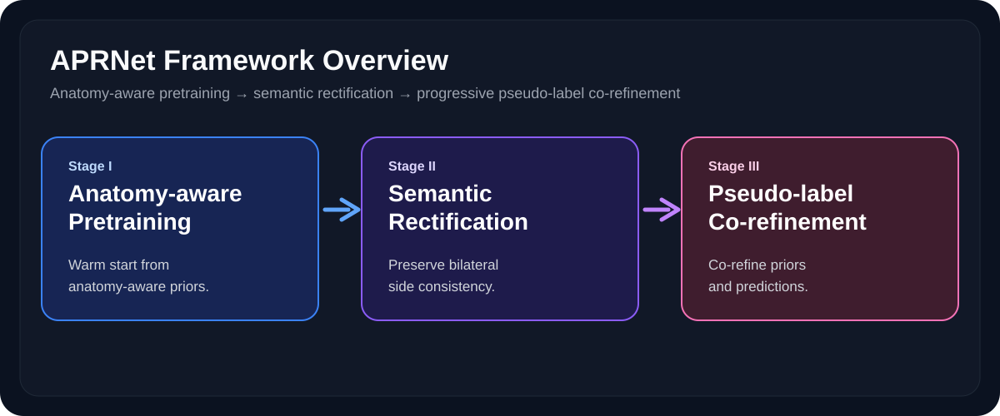
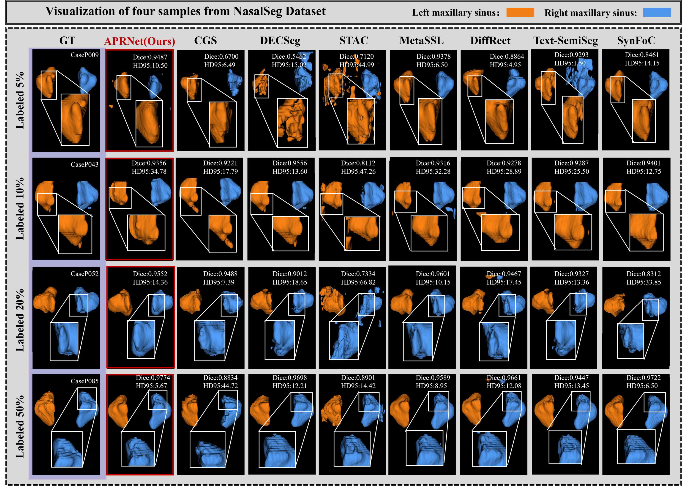

<div align="center">

# APRNet

**APRNet: Anatomy-guided Progressive Pseudo-label Rectification for Semi-supervised Maxillary Sinus Segmentation**

Semi-Supervised Maxillary Sinus Segmentation


<!--  -->
<p align="center">
  
</p>
<p align="center"><em>Figure 1: The overall three-stage pipeline of the proposed APRNet framework.</em></p>
</div>

## Overview

APRNet is a three-stage semi-supervised framework designed for anatomically constrained bilateral maxillary sinus segmentation.

- **Stage I – Anatomy-aware pretraining** initializes the segmentation network with robust aerated-region priors extracted from unlabeled scans.
- **Stage II – Semantic misalignment rectification (SMR)** improves labeled supervision with side-aware constraints that reduce left-right semantic confusion.
- **Stage III – Co-refined pseudo-label generation (CPG)** progressively fuses anatomical priors and model predictions to obtain cleaner unlabeled supervision.

This repository contains the core training, evaluation, prior modeling, loss design, and 3D backbone implementation used by APRNet.

## Abstract

Semi-supervised medical image segmentation aims to leverage large volumes of unlabeled data with extremely limited annotation budgets. For anatomically complex bilateral structures, random initialization, foreground semantic misalignment, and noisy pseudo-label accumulation can significantly undermine training stability. APRNet addresses this problem with a unified three-stage framework that combines anatomy-aware pretraining, semantic rectification, and progressive pseudo-label co-refinement for maxillary sinus segmentation.

## Method

APRNet follows a progressive training pipeline:

1. **Anatomy-aware pretraining** extracts stable aerated-region priors from unlabeled scans to warm-start the model.
2. **Semantic misalignment rectification (SMR)** imposes side-aware supervision to reduce left-right confusion and preserve bilateral exclusivity.
3. **Co-refined pseudo-label generation (CPG)** jointly uses prior guidance and segmentation responses to iteratively improve unlabeled supervision.

In practice, the framework is designed to improve three things at once: foreground localization, bilateral semantic consistency, and boundary quality.

<p align="center">
  
</p>
<p align="center"><em>Figure 2: Detailed illustration of the core modules in APRNet.</em></p>

## Highlights

- Unified `train.py` entry for `unsup`, `sup`, and `corefined` stages.
- Explicit bilateral semantic handling for left/right maxillary sinus consistency.
- Anatomy-aware prior extraction implemented in `PriorNet.py`.
- MONAI-based 3D training and sliding-window inference pipeline.
- Lightweight evaluation entry in `eval.py` for checkpoint-based testing.

## Repository Layout

```text
APRNet/
├── PriorNet.py      # anatomy-aware prior extraction and pretraining modules
├── VISTA3D.py       # 3D segmentation backbone builder
├── dataset.py       # data loading, transforms, split helpers, orientation checks
├── loss.py          # side-aware loss definitions
├── train.py         # unified three-stage training entry
├── eval.py          # checkpoint evaluation script
├── requirements.txt # minimal runtime dependencies
└── README.md
```

## Installation

```bash
python -m venv .venv
source .venv/bin/activate
pip install -r requirements.txt
```

If you are using CUDA, install the PyTorch build that matches your local driver before installing the remaining packages.

## Data Preparation

The code expects a dataset root and a split file:

```text
dataset_root/
├── images/...
├── labels/...
└── splits.json
```

Key notes:

- `dataset.py` contains orientation consistency checks to keep bilateral semantics aligned.
- `--split-json` defaults to `<dataset-root>/splits.json`.
- `--split-ratio` supports settings such as `5`, `10`, `20`, `50`, and `100`.

## Datasets

APRNet is organized around two public craniofacial datasets described in the manuscript:

- **NasalSeg**: 130 craniofacial 3D CT volumes with bilateral maxillary sinus annotations.
- **ToothFairy3**: a CBCT benchmark, from which 45 cases with complete bilateral maxillary sinus coverage and annotations are used in this project.

The experimental protocol uses an `8:2` train/test split and semi-supervised settings with `5%`, `10%`, `20%`, and `50%` labeled data.

## Training

### Stage I: anatomy-aware pretraining

```bash
python train.py \
  --stage unsup \
  --dataset-root /path/to/dataset_root \
  --split-ratio 20 \
  --gpu 0 \
  --amp
```

### Stage II: semantic misalignment rectification (SMR)

```bash
python train.py \
  --stage sup \
  --dataset-root /path/to/dataset_root \
  --split-ratio 20 \
  --init-checkpoint /path/to/stage1_checkpoint.pt \
  --gpu 0 \
  --amp
```

### Stage III: co-refined pseudo-label generation (CPG)

```bash
python train.py \
  --stage corefined \
  --dataset-root /path/to/dataset_root \
  --split-ratio 20 \
  --init-checkpoint /path/to/stage2_checkpoint.pt \
  --gpu 0 \
  --amp
```

## Evaluation

```bash
python eval.py \
  --checkpoint /path/to/checkpoint.pt \
  --dataset-root /path/to/dataset_root \
  --split-ratio 20 \
  --eval-key test \
  --gpu 0 \
  --amp
```

## Results

### Quantitative Comparison with SOTA Methods
<!-- <p align="center">
  
</p>
<p align="center"><em>Table 1: Quantitative comparison between APRNet and state-of-the-art methods.</em></p> -->
<p><strong>Comparison of maxillary sinus segmentation results on NasalSeg and ToothFairy3 under different labeled-data ratios.</strong> All methods are evaluated over three independent runs. Values are means and sample standard deviations across run-wise test-set averages. The 100% row is the fully supervised reference. Red and orange indicate the best and second-best results within each labeled-data ratio. BH-adjusted q markers compare APRNet with the best-performing competing method for each ratio, metric and side: *, ** and *** denote q &lt; 0.05, q &lt; 0.01 and q &lt; 0.001; ns denotes q ≥ 0.05. Markers indicate two-sided significance; the metric values determine the direction of the difference.</p>

<table border="1" cellpadding="4" cellspacing="0" style="width:100%; font-size:12px; border-collapse:collapse; text-align:center;">
  <thead><tr><th>Dataset</th><th>Ratio</th><th>Model</th><th>Dice ↑<br/>Left / Right</th><th>PPV ↑<br/>Left / Right</th><th>HD95 (mm) ↓<br/>Left / Right</th><th>ASSD (mm) ↓<br/>Left / Right</th></tr></thead>
  <tbody>
    <tr>
      <td rowspan="41" style="font-weight:bold;">NasalSeg</td>
      <td rowspan="1" style="font-weight:bold;">100%</td>
      <td>Fully supervised reference</td>
      <td>0.9767±0.0231 / 0.9887±0.0167</td>
      <td>0.9809±0.0228 / 0.9842±0.0154</td>
      <td>2.36±0.61 / 2.10±0.75</td>
      <td>0.70±0.08 / 0.72±0.11</td>
    </tr>
    <tr>
      <td rowspan="10" style="font-weight:bold;">5%</td>
      <td>CGS (TMI 2025)</td>
      <td>0.8465±0.0110 / 0.8419±0.0039</td>
      <td>0.7961±0.0208 / 0.7943±0.0081</td>
      <td>23.20±2.37 / 22.78±1.20</td>
      <td>5.68±0.72 / 5.67±0.26</td>
    </tr>
    <tr>
      <td>DECSeg (PR 2025)</td>
      <td>0.8780±0.0207 / 0.8878±0.0213</td>
      <td>0.8621±0.0233 / 0.8960±0.0233</td>
      <td><span style="color:orange">4.94±1.15</span> / <span style="color:orange">4.22±1.30</span></td>
      <td>2.66±0.83 / 2.53±0.88</td>
    </tr>
    <tr>
      <td>STAC (BIBM 2024)</td>
      <td>0.7900±0.0200 / 0.7600±0.0265</td>
      <td>0.6800±0.0300 / 0.6367±0.0404</td>
      <td>23.39±4.41 / 25.07±3.59</td>
      <td>5.25±1.13 / 6.10±0.92</td>
    </tr>
    <tr>
      <td>MetaSSL (TMI 2026)</td>
      <td>0.8422±0.0336 / 0.8208±0.0326</td>
      <td>0.7948±0.0511 / 0.7709±0.0453</td>
      <td>20.15±3.77 / 20.48±5.92</td>
      <td>3.62±0.70 / 3.83±0.92</td>
    </tr>
    <tr>
      <td>DiffRect (MICCAI 2024)</td>
      <td>0.8310±0.0126 / 0.8400±0.0188</td>
      <td>0.8390±0.0401 / 0.8317±0.0502</td>
      <td>24.37±1.92 / 26.40±1.40</td>
      <td>4.55±1.12 / 4.65±1.00</td>
    </tr>
    <tr>
      <td>Text-SemiSeg (MICCAI 2025)</td>
      <td>0.6413±0.0733 / 0.6474±0.0716</td>
      <td>0.5787±0.0886 / 0.5848±0.0687</td>
      <td>23.54±5.69 / 24.14±3.13</td>
      <td>8.89±3.22 / 8.64±2.27</td>
    </tr>
    <tr>
      <td>SynFoC (CVPR 2025)</td>
      <td><span style="color:orange">0.9034±0.0079</span> / <span style="color:orange">0.8914±0.0090</span></td>
      <td>0.8835±0.0204 / 0.8738±0.0198</td>
      <td>6.58±1.21 / 6.37±1.91</td>
      <td><span style="color:orange">1.14±0.04</span> / <span style="color:orange">1.16±0.16</span></td>
    </tr>
    <tr>
      <td>ERSR</td>
      <td>0.8968±0.0106 / 0.8723±0.0091</td>
      <td><span style="color:orange">0.9121±0.0291</span> / <span style="color:orange">0.9141±0.0161</span></td>
      <td>14.06±12.44 / 16.54±9.17</td>
      <td>1.91±1.37 / 2.54±1.13</td>
    </tr>
    <tr style="background-color:#e0e0e0; font-weight:bold;">
      <td>APRNet (Ours)</td>
      <td><span style="color:red">0.9196±0.0201</span> / <span style="color:red">0.9079±0.0288</span></td>
      <td><span style="color:red">0.9664±0.0135</span> / <span style="color:red">0.9588±0.0213</span></td>
      <td><span style="color:red">2.42±1.50</span> / <span style="color:red">2.41±1.16</span></td>
      <td><span style="color:red">0.47±0.24</span> / <span style="color:red">0.50±0.24</span></td>
    </tr>
    <tr style="color:#7030a0; border-top:1px dashed #999;"><td>BH-adjusted q</td><td>*** / ***</td><td>*** / ***</td><td>*** / ***</td><td>*** / ***</td></tr>
    <tr>
      <td rowspan="10" style="font-weight:bold;">10%</td>
      <td>CGS (TMI 2025)</td>
      <td>0.8534±0.0056 / 0.8484±0.0059</td>
      <td>0.7968±0.0095 / 0.7946±0.0147</td>
      <td>21.85±2.89 / 22.11±1.43</td>
      <td>5.70±0.28 / 5.65±0.08</td>
    </tr>
    <tr>
      <td>DECSeg (PR 2025)</td>
      <td>0.8929±0.0018 / 0.9018±0.0009</td>
      <td>0.8739±0.0020 / <span style="color:orange">0.9043±0.0029</span></td>
      <td><span style="color:orange">4.08±0.13</span> / <span style="color:orange">3.41±0.07</span></td>
      <td>2.14±0.02 / 2.00±0.01</td>
    </tr>
    <tr>
      <td>STAC (BIBM 2024)</td>
      <td>0.7967±0.0321 / 0.7467±0.0208</td>
      <td>0.6800±0.0436 / 0.6167±0.0306</td>
      <td>23.26±6.24 / 19.70±3.17</td>
      <td>4.99±1.45 / 5.20±0.77</td>
    </tr>
    <tr>
      <td>MetaSSL (TMI 2026)</td>
      <td>0.9119±0.0120 / 0.9002±0.0148</td>
      <td>0.8843±0.0157 / 0.8729±0.0126</td>
      <td>10.03±3.44 / 8.99±5.86</td>
      <td>2.12±0.63 / 2.36±0.71</td>
    </tr>
    <tr>
      <td>DiffRect (MICCAI 2024)</td>
      <td>0.8915±0.0059 / 0.8870±0.0149</td>
      <td>0.8828±0.0075 / 0.8846±0.0219</td>
      <td>22.33±1.93 / 23.52±4.84</td>
      <td>2.97±0.11 / 3.11±0.93</td>
    </tr>
    <tr>
      <td>Text-SemiSeg (MICCAI 2025)</td>
      <td>0.8699±0.0082 / 0.8858±0.0094</td>
      <td>0.7937±0.0082 / 0.8086±0.0100</td>
      <td>12.08±2.52 / 9.50±0.32</td>
      <td>2.51±0.11 / 1.81±0.16</td>
    </tr>
    <tr>
      <td>SynFoC (CVPR 2025)</td>
      <td>0.9047±0.0178 / 0.9000±0.0218</td>
      <td>0.8866±0.0054 / 0.8677±0.0114</td>
      <td>5.13±1.32 / 4.87±3.16</td>
      <td><span style="color:orange">0.97±0.24</span> / <span style="color:orange">0.99±0.39</span></td>
    </tr>
    <tr>
      <td>ERSR</td>
      <td><span style="color:orange">0.9196±0.0099</span> / <span style="color:orange">0.9097±0.0021</span></td>
      <td><span style="color:orange">0.8984±0.0148</span> / 0.8920±0.0204</td>
      <td>19.24±5.98 / 14.34±5.42</td>
      <td>2.33±0.82 / 2.39±0.73</td>
    </tr>
    <tr style="background-color:#e0e0e0; font-weight:bold;">
      <td>APRNet (Ours)</td>
      <td><span style="color:red">0.9338±0.0175</span> / <span style="color:red">0.9356±0.0167</span></td>
      <td><span style="color:red">0.9592±0.0065</span> / <span style="color:red">0.9525±0.0134</span></td>
      <td><span style="color:red">1.55±0.65</span> / <span style="color:red">1.73±0.82</span></td>
      <td><span style="color:red">0.29±0.10</span> / <span style="color:red">0.32±0.13</span></td>
    </tr>
    <tr style="color:#7030a0; border-top:1px dashed #999;"><td>BH-adjusted q</td><td>*** / ***</td><td>*** / ***</td><td>*** / ***</td><td>*** / ***</td></tr>
    <tr>
      <td rowspan="10" style="font-weight:bold;">20%</td>
      <td>CGS (TMI 2025)</td>
      <td>0.8529±0.0156 / 0.8462±0.0091</td>
      <td>0.7931±0.0257 / 0.7890±0.0130</td>
      <td>22.94±5.88 / 20.61±2.46</td>
      <td>5.90±1.00 / 5.70±0.58</td>
    </tr>
    <tr>
      <td>DECSeg (PR 2025)</td>
      <td>0.9092±0.0203 / 0.9152±0.0233</td>
      <td>0.8938±0.0206 / <span style="color:orange">0.9216±0.0221</span></td>
      <td><span style="color:orange">3.30±1.15</span> / <span style="color:orange">2.69±1.13</span></td>
      <td>1.59±0.92 / 1.46±0.91</td>
    </tr>
    <tr>
      <td>STAC (BIBM 2024)</td>
      <td>0.7933±0.0058 / 0.7800±0.0300</td>
      <td>0.6733±0.0058 / 0.6667±0.0351</td>
      <td>22.07±0.06 / 25.19±13.62</td>
      <td>4.75±0.18 / 5.84±2.83</td>
    </tr>
    <tr>
      <td>MetaSSL (TMI 2026)</td>
      <td>0.9079±0.0102 / 0.9011±0.0090</td>
      <td>0.8773±0.0178 / 0.8747±0.0118</td>
      <td>13.77±6.70 / 11.42±4.65</td>
      <td>2.55±0.99 / 2.53±0.78</td>
    </tr>
    <tr>
      <td>DiffRect (MICCAI 2024)</td>
      <td>0.9025±0.0071 / 0.9061±0.0001</td>
      <td><span style="color:orange">0.8973±0.0193</span> / 0.9084±0.0162</td>
      <td>17.90±4.91 / 14.47±4.56</td>
      <td>2.62±0.53 / 2.20±0.60</td>
    </tr>
    <tr>
      <td>Text-SemiSeg (MICCAI 2025)</td>
      <td>0.8904±0.0052 / 0.8954±0.0036</td>
      <td>0.8146±0.0062 / 0.8180±0.0061</td>
      <td>8.79±5.16 / 7.99±2.00</td>
      <td>1.87±0.42 / 1.54±0.22</td>
    </tr>
    <tr>
      <td>SynFoC (CVPR 2025)</td>
      <td>0.9116±0.0041 / 0.8986±0.0106</td>
      <td>0.8852±0.0048 / 0.8667±0.0206</td>
      <td>6.07±2.35 / 5.12±1.79</td>
      <td><span style="color:orange">1.00±0.21</span> / <span style="color:orange">1.06±0.23</span></td>
    </tr>
    <tr>
      <td>ERSR</td>
      <td><span style="color:orange">0.9258±0.0102</span> / <span style="color:orange">0.9181±0.0034</span></td>
      <td>0.8970±0.0220 / 0.9034±0.0037</td>
      <td>12.44±10.41 / 8.86±3.15</td>
      <td>1.71±1.18 / 1.63±0.19</td>
    </tr>
    <tr style="background-color:#e0e0e0; font-weight:bold;">
      <td>APRNet (Ours)</td>
      <td><span style="color:red">0.9524±0.0046</span> / <span style="color:red">0.9497±0.0103</span></td>
      <td><span style="color:red">0.9539±0.0502</span> / <span style="color:red">0.9628±0.0542</span></td>
      <td><span style="color:red">1.05±1.57</span> / <span style="color:red">1.08±1.46</span></td>
      <td><span style="color:red">0.22±0.35</span> / <span style="color:red">0.22±0.33</span></td>
    </tr>
    <tr style="color:#7030a0; border-top:1px dashed #999;"><td>BH-adjusted q</td><td>*** / ***</td><td>*** / ***</td><td>*** / ***</td><td>*** / ***</td></tr>
    <tr>
      <td rowspan="10" style="font-weight:bold;">50%</td>
      <td>CGS (TMI 2025)</td>
      <td>0.8789±0.0090 / 0.8749±0.0035</td>
      <td>0.8487±0.0208 / 0.8458±0.0100</td>
      <td>17.69±3.54 / 13.09±0.44</td>
      <td>4.65±0.53 / 4.30±0.08</td>
    </tr>
    <tr>
      <td>DECSeg (PR 2025)</td>
      <td>0.9114±0.0189 / 0.9171±0.0174</td>
      <td>0.8973±0.0180 / <span style="color:orange">0.9225±0.0199</span></td>
      <td><span style="color:orange">3.30±1.11</span> / <span style="color:orange">2.67±1.07</span></td>
      <td>1.56±0.92 / 1.45±0.90</td>
    </tr>
    <tr>
      <td>STAC (BIBM 2024)</td>
      <td>0.8100±0.0200 / 0.8133±0.0058</td>
      <td>0.6967±0.0252 / 0.7167±0.0058</td>
      <td>18.13±2.77 / 12.05±0.41</td>
      <td>3.83±0.51 / 3.17±0.23</td>
    </tr>
    <tr>
      <td>MetaSSL (TMI 2026)</td>
      <td><span style="color:orange">0.9261±0.0032</span> / 0.9182±0.0068</td>
      <td>0.9131±0.0049 / 0.9098±0.0135</td>
      <td>8.40±1.39 / 6.32±0.93</td>
      <td>1.70±0.25 / 1.67±0.19</td>
    </tr>
    <tr>
      <td>DiffRect (MICCAI 2024)</td>
      <td>0.9093±0.0058 / 0.9090±0.0018</td>
      <td><span style="color:orange">0.9178±0.0125</span> / 0.9087±0.0068</td>
      <td>16.06±3.03 / 24.10±5.98</td>
      <td>2.09±0.32 / 2.59±0.45</td>
    </tr>
    <tr>
      <td>Text-SemiSeg (MICCAI 2025)</td>
      <td>0.8966±0.0108 / 0.9075±0.0049</td>
      <td>0.8308±0.0073 / 0.8404±0.0040</td>
      <td>5.33±1.95 / 4.62±0.71</td>
      <td>1.54±0.18 / 1.14±0.18</td>
    </tr>
    <tr>
      <td>SynFoC (CVPR 2025)</td>
      <td>0.9051±0.0055 / 0.9051±0.0038</td>
      <td>0.8784±0.0171 / 0.8907±0.0088</td>
      <td>8.48±1.84 / 6.10±1.60</td>
      <td>1.30±0.14 / <span style="color:orange">1.07±0.14</span></td>
    </tr>
    <tr>
      <td>ERSR</td>
      <td>0.9214±0.0066 / <span style="color:orange">0.9186±0.0078</span></td>
      <td>0.9154±0.0221 / 0.9032±0.0242</td>
      <td>10.06±4.36 / 13.72±8.34</td>
      <td><span style="color:orange">1.29±0.32</span> / 2.27±1.21</td>
    </tr>
    <tr style="background-color:#e0e0e0; font-weight:bold;">
      <td>APRNet (Ours)</td>
      <td><span style="color:red">0.9597±0.0054</span> / <span style="color:red">0.9576±0.0049</span></td>
      <td><span style="color:red">0.9530±0.0041</span> / <span style="color:red">0.9537±0.0061</span></td>
      <td><span style="color:red">0.83±0.18</span> / <span style="color:red">1.15±0.11</span></td>
      <td><span style="color:red">0.18±0.04</span> / <span style="color:red">0.21±0.04</span></td>
    </tr>
    <tr style="color:#7030a0; border-top:1px dashed #999;"><td>BH-adjusted q</td><td>*** / ***</td><td>*** / ***</td><td>*** / ***</td><td>*** / ***</td></tr>
    <tr>
      <td rowspan="41" style="font-weight:bold;">ToothFairy3</td>
      <td rowspan="1" style="font-weight:bold;">100%</td>
      <td>Fully supervised reference</td>
      <td>0.9661±0.0123 / 0.9723±0.0284</td>
      <td>0.9818±0.0288 / 0.9691±0.0129</td>
      <td>3.75±0.91 / 2.91±0.75</td>
      <td>0.72±0.11 / 0.88±0.25</td>
    </tr>
    <tr>
      <td rowspan="10" style="font-weight:bold;">5%</td>
      <td>CGS (TMI 2025)</td>
      <td>0.3038±0.0201 / 0.2543±0.0578</td>
      <td>0.4107±0.0853 / 0.2753±0.0698</td>
      <td>68.45±17.28 / 75.66±8.64</td>
      <td>16.32±6.28 / 22.04±4.02</td>
    </tr>
    <tr>
      <td>DECSeg (PR 2025)</td>
      <td>0.4902±0.1566 / 0.5181±0.0691</td>
      <td>0.6146±0.2554 / 0.4990±0.0911</td>
      <td>43.35±27.81 / 50.58±18.00</td>
      <td>13.75±14.36 / 13.47±7.00</td>
    </tr>
    <tr>
      <td>STAC (BIBM 2024)</td>
      <td>0.6529±0.1728 / 0.6331±0.1683</td>
      <td>0.8268±0.1165 / 0.6507±0.0956</td>
      <td><span style="color:orange">8.58±6.27</span> / <span style="color:orange">14.57±4.49</span></td>
      <td><span style="color:orange">2.43±2.33</span> / 3.90±1.53</td>
    </tr>
    <tr>
      <td>MetaSSL (TMI 2026)</td>
      <td><span style="color:orange">0.7087±0.0135</span> / 0.6764±0.0710</td>
      <td>0.6736±0.0175 / 0.6792±0.0254</td>
      <td>18.99±4.91 / 22.77±0.58</td>
      <td>4.32±0.52 / 4.47±0.31</td>
    </tr>
    <tr>
      <td>DiffRect (MICCAI 2024)</td>
      <td>0.6377±0.0584 / 0.5836±0.0665</td>
      <td>0.7886±0.0775 / 0.7621±0.1037</td>
      <td>33.43±9.63 / 29.86±10.66</td>
      <td>5.36±2.64 / 5.97±2.56</td>
    </tr>
    <tr>
      <td>Text-SemiSeg (MICCAI 2025)</td>
      <td>0.5105±0.0525 / 0.5041±0.0306</td>
      <td>0.4676±0.0263 / 0.3976±0.0180</td>
      <td>61.52±1.39 / 59.16±1.73</td>
      <td>13.83±0.52 / 19.13±1.45</td>
    </tr>
    <tr>
      <td>SynFoC (CVPR 2025)</td>
      <td>0.6762±0.0130 / <span style="color:red">0.8654±0.0222</span></td>
      <td><span style="color:red">0.9204±0.0273</span> / <span style="color:red">0.9577±0.0080</span></td>
      <td><span style="color:red">3.29±1.01</span> / <span style="color:red">1.96±0.79</span></td>
      <td><span style="color:red">0.92±0.09</span> / <span style="color:red">0.47±0.09</span></td>
    </tr>
    <tr>
      <td>ERSR</td>
      <td>0.0854±0.0658 / 0.2095±0.0336</td>
      <td>0.2046±0.0664 / 0.3941±0.2768</td>
      <td>50.72±11.98 / 80.08±10.20</td>
      <td>24.83±5.14 / 25.28±20.21</td>
    </tr>
    <tr style="background-color:#e0e0e0; font-weight:bold;">
      <td>APRNet (Ours)</td>
      <td><span style="color:red">0.7824±0.0905</span> / <span style="color:orange">0.7830±0.0958</span></td>
      <td><span style="color:orange">0.9087±0.0727</span> / <span style="color:orange">0.8768±0.1048</span></td>
      <td>17.10±15.93 / 16.76±17.92</td>
      <td>2.62±1.97 / <span style="color:orange">3.04±2.89</span></td>
    </tr>
    <tr style="color:#7030a0; border-top:1px dashed #999;"><td>BH-adjusted q</td><td>*** / ***</td><td>*** / ***</td><td>** / ***</td><td>ns / ***</td></tr>
    <tr>
      <td rowspan="10" style="font-weight:bold;">10%</td>
      <td>CGS (TMI 2025)</td>
      <td>0.5629±0.0654 / 0.5074±0.0416</td>
      <td>0.4869±0.0783 / 0.4692±0.0739</td>
      <td>80.51±4.75 / 76.16±8.12</td>
      <td>21.19±5.61 / 19.36±5.02</td>
    </tr>
    <tr>
      <td>DECSeg (PR 2025)</td>
      <td>0.7935±0.0111 / 0.6415±0.1535</td>
      <td><span style="color:orange">0.9808±0.0036</span> / 0.9414±0.0571</td>
      <td><span style="color:red">3.75±0.44</span> / 7.98±7.35</td>
      <td><span style="color:red">0.72±0.07</span> / 5.03±6.71</td>
    </tr>
    <tr>
      <td>STAC (BIBM 2024)</td>
      <td>0.7925±0.1407 / 0.7983±0.1233</td>
      <td>0.8539±0.1030 / 0.9228±0.0429</td>
      <td>4.40±3.10 / <span style="color:orange">2.50±1.57</span></td>
      <td><span style="color:orange">1.01±0.80</span> / <span style="color:orange">0.70±0.58</span></td>
    </tr>
    <tr>
      <td>MetaSSL (TMI 2026)</td>
      <td><span style="color:orange">0.8386±0.0207</span> / 0.8324±0.0440</td>
      <td>0.8143±0.0239 / 0.8526±0.0391</td>
      <td>14.32±3.58 / 11.81±5.26</td>
      <td>2.56±0.70 / 2.35±0.91</td>
    </tr>
    <tr>
      <td>DiffRect (MICCAI 2024)</td>
      <td>0.8270±0.0916 / 0.7781±0.2139</td>
      <td><span style="color:red">0.9855±0.0086</span> / <span style="color:orange">0.9632±0.0171</span></td>
      <td>8.29±6.62 / 28.29±45.29</td>
      <td>1.76±1.12 / 4.03±4.34</td>
    </tr>
    <tr>
      <td>Text-SemiSeg (MICCAI 2025)</td>
      <td>0.7375±0.0437 / 0.6637±0.0383</td>
      <td>0.6262±0.0591 / 0.5294±0.0477</td>
      <td>63.03±3.88 / 65.58±5.13</td>
      <td>12.14±3.06 / 16.46±2.77</td>
    </tr>
    <tr>
      <td>SynFoC (CVPR 2025)</td>
      <td>0.7006±0.0035 / <span style="color:orange">0.8761±0.0266</span></td>
      <td>0.8627±0.0091 / <span style="color:red">0.9644±0.0050</span></td>
      <td><span style="color:orange">4.23±0.78</span> / <span style="color:red">1.44±0.15</span></td>
      <td>1.53±0.60 / <span style="color:red">0.36±0.03</span></td>
    </tr>
    <tr>
      <td>ERSR</td>
      <td>0.7316±0.1169 / 0.7132±0.1057</td>
      <td>0.8785±0.0299 / 0.8579±0.0212</td>
      <td>23.61±11.69 / 48.11±10.52</td>
      <td>4.47±1.60 / 6.68±0.86</td>
    </tr>
    <tr style="background-color:#e0e0e0; font-weight:bold;">
      <td>APRNet (Ours)</td>
      <td><span style="color:red">0.8631±0.0351</span> / <span style="color:red">0.8785±0.0609</span></td>
      <td>0.9170±0.0347 / 0.9245±0.0311</td>
      <td>9.51±9.55 / 8.38±10.30</td>
      <td>1.46±0.98 / 1.58±1.38</td>
    </tr>
    <tr style="color:#7030a0; border-top:1px dashed #999;"><td>BH-adjusted q</td><td>* / **</td><td>ns / ***</td><td>** / ***</td><td>*** / ***</td></tr>
    <tr>
      <td rowspan="10" style="font-weight:bold;">20%</td>
      <td>CGS (TMI 2025)</td>
      <td>0.5978±0.0530 / 0.5988±0.0708</td>
      <td>0.4728±0.0741 / 0.5436±0.1074</td>
      <td>84.32±1.55 / 75.26±10.61</td>
      <td>26.63±6.08 / 18.87±9.23</td>
    </tr>
    <tr>
      <td>DECSeg (PR 2025)</td>
      <td>0.8820±0.0288 / 0.8952±0.0169</td>
      <td>0.8928±0.0846 / 0.9341±0.0444</td>
      <td>38.41±34.77 / 4.48±4.53</td>
      <td>6.83±6.74 / 1.08±0.63</td>
    </tr>
    <tr>
      <td>STAC (BIBM 2024)</td>
      <td>0.8224±0.1051 / 0.8451±0.0762</td>
      <td>0.8602±0.0907 / 0.8791±0.0725</td>
      <td><span style="color:orange">4.17±2.91</span> / <span style="color:orange">3.47±2.96</span></td>
      <td>0.94±0.73 / 0.70±0.47</td>
    </tr>
    <tr>
      <td>MetaSSL (TMI 2026)</td>
      <td><span style="color:orange">0.8880±0.0359</span> / 0.8949±0.0365</td>
      <td>0.8809±0.0662 / 0.9051±0.0511</td>
      <td>8.88±5.54 / 8.83±5.24</td>
      <td>1.62±1.08 / 1.52±0.65</td>
    </tr>
    <tr>
      <td>DiffRect (MICCAI 2024)</td>
      <td>0.8877±0.0196 / 0.8973±0.0104</td>
      <td><span style="color:red">0.9567±0.0102</span> / 0.9589±0.0066</td>
      <td>7.11±6.27 / 7.36±5.41</td>
      <td>0.88±0.65 / 1.02±0.81</td>
    </tr>
    <tr>
      <td>Text-SemiSeg (MICCAI 2025)</td>
      <td>0.8008±0.0195 / 0.7837±0.0323</td>
      <td>0.7128±0.0311 / 0.6759±0.0408</td>
      <td>60.89±4.56 / 67.13±1.74</td>
      <td>8.92±0.42 / 10.25±0.91</td>
    </tr>
    <tr>
      <td>SynFoC (CVPR 2025)</td>
      <td>0.7567±0.0498 / <span style="color:orange">0.9048±0.0198</span></td>
      <td>0.9019±0.0516 / <span style="color:red">0.9597±0.0043</span></td>
      <td>5.54±2.85 / 3.53±3.41</td>
      <td><span style="color:orange">0.84±0.30</span> / <span style="color:orange">0.47±0.15</span></td>
    </tr>
    <tr>
      <td>ERSR</td>
      <td>0.6550±0.1487 / 0.7851±0.0675</td>
      <td>0.7301±0.0827 / 0.7407±0.0973</td>
      <td>43.14±7.13 / 74.99±5.94</td>
      <td>9.74±3.32 / 13.93±2.75</td>
    </tr>
    <tr style="background-color:#e0e0e0; font-weight:bold;">
      <td>APRNet (Ours)</td>
      <td><span style="color:red">0.9339±0.0197</span> / <span style="color:red">0.9407±0.0203</span></td>
      <td><span style="color:orange">0.9565±0.0266</span> / <span style="color:orange">0.9591±0.0125</span></td>
      <td><span style="color:red">2.14±0.84</span> / <span style="color:red">0.56±0.22</span></td>
      <td><span style="color:red">0.25±0.10</span> / <span style="color:red">0.09±0.03</span></td>
    </tr>
    <tr style="color:#7030a0; border-top:1px dashed #999;"><td>BH-adjusted q</td><td>*** / ***</td><td>*** / ***</td><td>*** / ***</td><td>*** / ***</td></tr>
    <tr>
      <td rowspan="10" style="font-weight:bold;">50%</td>
      <td>CGS (TMI 2025)</td>
      <td>0.6209±0.1084 / 0.5518±0.0120</td>
      <td>0.5163±0.1275 / 0.4600±0.0177</td>
      <td>76.59±10.37 / 80.82±5.15</td>
      <td>24.89±9.87 / 24.25±3.84</td>
    </tr>
    <tr>
      <td>DECSeg (PR 2025)</td>
      <td><span style="color:orange">0.9246±0.0122</span> / 0.8821±0.0393</td>
      <td>0.9561±0.0068 / 0.9582±0.0084</td>
      <td><span style="color:orange">1.79±1.35</span> / 2.30±1.10</td>
      <td>0.48±0.25 / 0.54±0.21</td>
    </tr>
    <tr>
      <td>STAC (BIBM 2024)</td>
      <td>0.8512±0.1222 / 0.8279±0.1166</td>
      <td>0.9242±0.0426 / 0.8870±0.0712</td>
      <td>2.21±1.94 / 2.11±1.14</td>
      <td>0.52±0.49 / 0.61±0.43</td>
    </tr>
    <tr>
      <td>MetaSSL (TMI 2026)</td>
      <td>0.9112±0.0286 / 0.9182±0.0179</td>
      <td>0.9388±0.0253 / 0.9396±0.0327</td>
      <td>4.25±3.20 / 6.34±6.57</td>
      <td>0.84±0.46 / 1.23±0.83</td>
    </tr>
    <tr>
      <td>DiffRect (MICCAI 2024)</td>
      <td>0.8864±0.0314 / 0.8797±0.0428</td>
      <td><span style="color:red">0.9681±0.0045</span> / <span style="color:red">0.9704±0.0050</span></td>
      <td>2.39±1.12 / 5.28±6.57</td>
      <td><span style="color:orange">0.42±0.22</span> / 0.42±0.18</td>
    </tr>
    <tr>
      <td>Text-SemiSeg (MICCAI 2025)</td>
      <td>0.8906±0.0108 / 0.8912±0.0103</td>
      <td>0.8475±0.0162 / 0.8449±0.0105</td>
      <td>47.88±6.81 / 55.21±8.69</td>
      <td>4.37±1.09 / 5.56±1.25</td>
    </tr>
    <tr>
      <td>SynFoC (CVPR 2025)</td>
      <td>0.8088±0.0539 / <span style="color:orange">0.9317±0.0096</span></td>
      <td><span style="color:orange">0.9678±0.0055</span> / <span style="color:orange">0.9664±0.0035</span></td>
      <td>2.42±1.22 / <span style="color:orange">0.94±0.02</span></td>
      <td>0.82±0.54 / <span style="color:orange">0.20±0.01</span></td>
    </tr>
    <tr>
      <td>ERSR</td>
      <td>0.8509±0.0135 / 0.8503±0.0229</td>
      <td>0.8175±0.0285 / 0.8396±0.0640</td>
      <td>67.52±3.26 / 59.10±15.16</td>
      <td>8.84±0.70 / 7.28±3.70</td>
    </tr>
    <tr style="background-color:#e0e0e0; font-weight:bold;">
      <td>APRNet (Ours)</td>
      <td><span style="color:red">0.9351±0.0239</span> / <span style="color:red">0.9442±0.0159</span></td>
      <td>0.9550±0.0302 / 0.9545±0.0084</td>
      <td><span style="color:red">1.67±1.46</span> / <span style="color:red">0.51±0.18</span></td>
      <td><span style="color:red">0.22±0.17</span> / <span style="color:red">0.09±0.03</span></td>
    </tr>
    <tr style="color:#7030a0; border-top:1px dashed #999;"><td>BH-adjusted q</td><td>*** / **</td><td>*** / ***</td><td>*** / ***</td><td>*** / ***</td></tr>
  </tbody>
</table>
<p align="center"><em>Table 1: Quantitative comparison between APRNet and state-of-the-art methods.</em></p>

### Qualitative Visualization Results
<p align="center">
  
</p>
<p align="center"><em>Figure 3: Qualitative visualization of maxillary sinus segmentation results.</em></p>

### Comprehensive Ablation Study (20% Labeled Data)
<p><strong>Stage-wise ablation results for the left and right maxillary sinuses.</strong> Stages I, II and III denote anatomy-aware pretraining, semantic misalignment rectification (SMR) and co-refined pseudo-label generation (CPG), respectively. Learned variants report means and sample standard deviations across three independent runs on NasalSeg with 20% labeled data. E1 is the deterministic non-learning prior. E2 reports bilateral metrics after spatial side assignment.</p>

<table border="1" cellpadding="6" cellspacing="0" style="width:100%; font-size:14px; border-collapse:collapse; text-align:center; margin:1em 0;">
  <thead>
    <tr style="border-bottom: 2px solid #333;">
      <th rowspan="2">ID</th>
      <th colspan="3">Stage</th>
      <th rowspan="2">Dice<sub>fg</sub></th>
      <th colspan="4">Left / Right Maxillary Sinus</th>
    </tr>
    <tr style="border-bottom: 1px solid #333;">
      <th>I</th>
      <th>II</th>
      <th>III</th>
      <th>Dice ↑</th>
      <th>PPV ↑</th>
      <th>HD95 (mm) ↓</th>
      <th>ASSD (mm) ↓</th>
    </tr>
  </thead>
  <tbody>
    <tr><td>E1</td><td></td><td></td><td></td><td>0.5286</td><td>0.5189±0.3214 / 0.5361±0.2659</td><td>0.8328±0.2128 / 0.7912±0.2322</td><td>15.33±7.21 / 14.59±8.08</td><td>5.54±1.07 / 5.79±1.45</td></tr>
    <tr><td>E2</td><td>✅</td><td></td><td></td><td>0.7678</td><td>0.7514±0.2384 / 0.7744±0.2601</td><td>0.9626±0.0547 / 0.9188±0.1336</td><td>6.06±10.50 / 4.56±7.81</td><td>1.50±1.28 / 1.26±1.24</td></tr>
    <tr><td>E3</td><td></td><td>✅</td><td></td><td>0.2782</td><td>0.2801±0.2279 / 0.3761±0.3291</td><td>0.3426±0.2157 / 0.3405±0.1163</td><td>36.47±6.99 / 35.36±6.99</td><td>9.28±1.45 / 9.26±1.49</td></tr>
    <tr><td>E4</td><td></td><td></td><td>✅</td><td>0.6758</td><td>0.6892±0.0165 / 0.6966±0.0211</td><td>0.8654±0.0121 / 0.8558±0.0325</td><td>29.31±3.56 / 36.25±5.32</td><td>7.26±0.36 / 6.68±1.25</td></tr>
    <tr><td>E5</td><td>✅</td><td>✅</td><td></td><td>0.8660</td><td>0.8954±0.0438 / 0.8314±0.0899</td><td>0.9066±0.0786 / 0.8523±0.1352</td><td>7.73±7.34 / 17.60±6.73</td><td>1.15±0.98 / 2.71±1.31</td></tr>
    <tr><td>E6</td><td>✅</td><td></td><td>✅</td><td>0.9034</td><td>0.7135±0.0162 / 0.6954±0.1125</td><td>0.6995±0.0698 / 0.6952±0.0139</td><td>18.33±2.21 / 22.21±1.29</td><td>7.56±0.58 / 6.99±2.21</td></tr>
    <tr><td>E7</td><td></td><td>✅</td><td>✅</td><td>0.3572</td><td>0.3893±0.1432 / 0.3368±0.1568</td><td>0.5019±0.0895 / 0.4484±0.0842</td><td>33.63±6.83 / 41.82±8.81</td><td>8.12±1.23 / 5.11±0.86</td></tr>
    <tr style="font-weight:bold; border-top:1px solid #333;"><td>E8 (Full)</td><td>✅</td><td>✅</td><td>✅</td><td>0.9458</td><td>0.9524±0.0046 / 0.9497±0.0103</td><td>0.9539±0.0502 / 0.9628±0.0542</td><td>1.05±1.57 / 1.08±1.46</td><td>0.22±0.35 / 0.22±0.33</td></tr>
  </tbody>
</table>
<p align="center"><em>Table 2: Comprehensive ablation study results for the left and right maxillary sinuses under 20% labeled data.</em></p>

### Key takeaways:
- **Stage I** increases foreground Dice from 0.5286 for the non-learning prior (E1) to 0.7678 (E2).
- **Stage II** increases mean bilateral Dice from 0.7629 (E2) to 0.8634 (E5).
- **Full APRNet** reaches mean bilateral Dice 0.9511 (E8), compared with 0.8634 after Stages I and II, and reduces mean HD95 from 12.67 to 1.06 mm.

## Citation

If you use this repository in your work, please cite the APRNet paper:

```bibtex
@article{aprnet2025,
  title   = {APRNet: Anatomy-guided Progressive Pseudo-label Rectification for Semi-supervised Maxillary Sinus Segmentation},
  author  = {Anonymous},
  journal = {Under preparation},
  year    = {2025}
}
```
